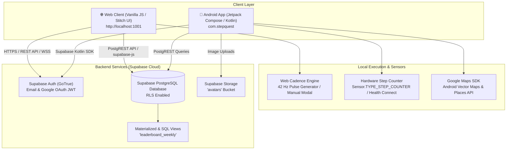
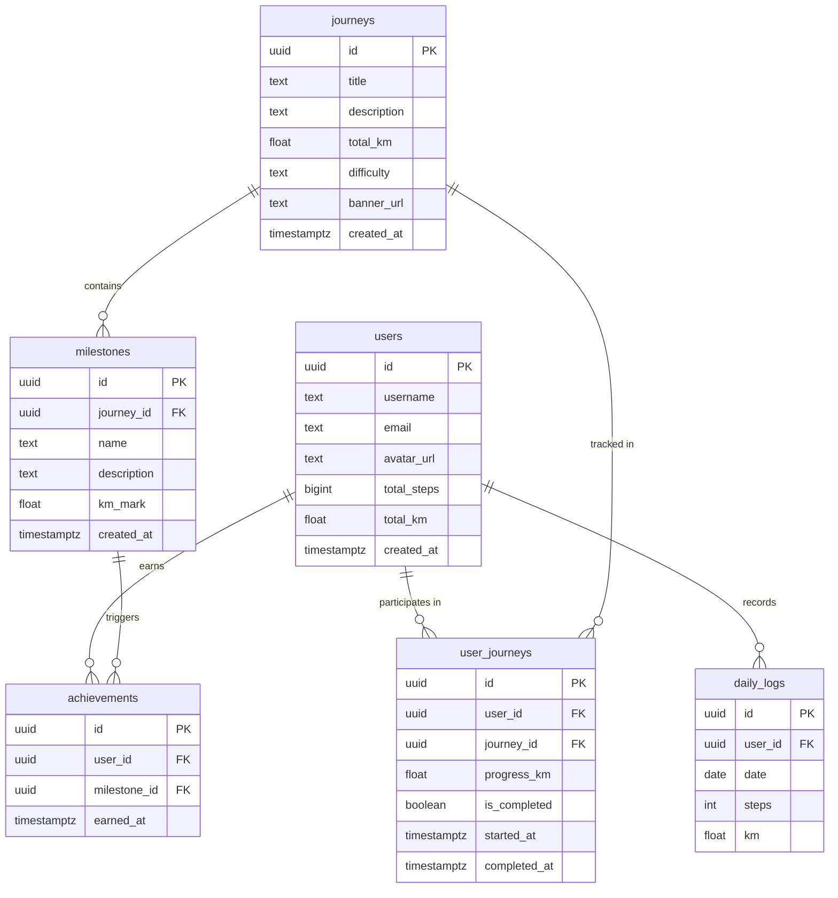
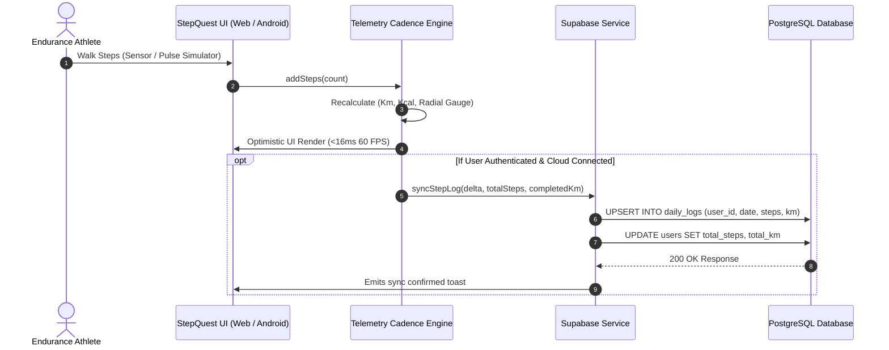

# 🏗️ StepQuest — System Architecture (`ARCHITECTURE.md`)

---

## 1. High-Level System Architecture

StepQuest operates on a unified multi-client cloud architecture connecting a **Single Page Web Application** and a **Native Android Application** to a centralized **Supabase PostgreSQL** cloud backend.

---

## 2. Client Architecture

### 2.1 Web Application (`web/`)
- **Philosophy:** Zero external heavyweight bundler dependency; uses native ES6 JavaScript, native DOM manipulation, and Tailwind CSS via CDN.
- **Components:**
  - `server.js`: Built-in Node.js HTTP server. Serves static files, SPA fallback routes, `/api/health`, and `/api/config` (extracts environment variables and `local.properties`).
  - `supabase_service.js`: Singleton service controller (`window.StepQuestSupabase`) managing connection state, authentication sessions, and cloud database operations.
  - `stitch_app.js`: Main telemetry state controller (`StepQuestTelemetry`) managing the 10,000-step gauge, modal events, active quest synchronization, and keyboard shortcuts.
  - `index.html`: Unified single-page document housing all 5 primary views (`view-dashboard`, `view-quests`, `view-trail-map`, `view-leaderboard`, `view-achievements`).

### 2.2 Native Android Application (`app/`)
- **Pattern:** Clean Architecture + MVVM (Model-View-ViewModel) with Dagger Hilt dependency injection.
- **Layers:**
  - `presentation/`: Jetpack Compose screens, Material 3 design tokens (`Theme.kt`, `Color.kt`), and stateful ViewModels (`HomeViewModel`, `JourneyViewModel`, `LeaderboardViewModel`, `AuthViewModel`).
  - `domain/`: Pure Kotlin models (`Journey`, `Milestone`, `User`, `DailyLog`) and UseCases (`CheckMilestonesUseCase`, `StartJourneyUseCase`, `UpdateProgressUseCase`).
  - `data/`: Repositories (`JourneyRepositoryImpl`, `StepRepositoryImpl`), Room local database caching, and remote data sources using `io.github.jan-tennert.supabase` Kotlin SDK.
  - `utils/`: Background workers (`StepSyncWorker` via Android WorkManager), hardware pedometer manager (`StepSensorManager`), and foreground service notifications (`StepCounterService`).

---

## 3. Database Schema & Data Models

The database runs on PostgreSQL 15+ hosted on Supabase, fully documented in [`Supabase_Schema.sql`](file:///e:/Stepquest/Supabase_Schema.sql).

---

## 4. Telemetry Pipeline & Synchronization

---

## 5. Security & Row-Level Security (RLS)

StepQuest enforces granular PostgreSQL Row-Level Security:
1. **`users` Table:**
   - Public read access for leaderboard username and totals (`Public leaderboard read`).
   - Write and update access strictly limited to the authenticated account owner (`auth.uid() = id`).
2. **`journeys` & `milestones` Tables:**
   - Public read access enabled for all clients (`Anyone can read journeys / milestones`).
   - Write access restricted to service-role admin tokens.
3. **`daily_logs` & `user_journeys` Tables:**
   - Read/write access strictly restricted to the owning user (`auth.uid() = user_id`).
4. **`avatars` Storage Bucket:**
   - Public read access for avatar images.
   - Insert access restricted to user's assigned folder prefix (`auth.uid()::text = (storage.foldername(name))[1]`).

---

## 6. Deployment & Environment Strategy

### 6.1 Web Application
- **Zero-Build Architecture:** Runs directly in any modern browser.
- **Hosting Options:** Vercel, Netlify, Render, or a Node container running `node web/server.js`.
- **Environment Discovery:** Automatic detection via `/api/config` from `local.properties` or standard environment variables (`SUPABASE_URL`, `SUPABASE_ANON_KEY`).

### 6.2 Native Android App
- **Build Tooling:** Gradle 8.2+, Android Gradle Plugin 8.3+, Kotlin 1.9.
- **Signing & ProGuard:** Configured in `app/build.gradle.kts` using release keystore (`stepquest-release.jks`) and `proguard-rules.pro` optimization.
- **Distribution:** Google Play Console internal testing / production AAB track.
